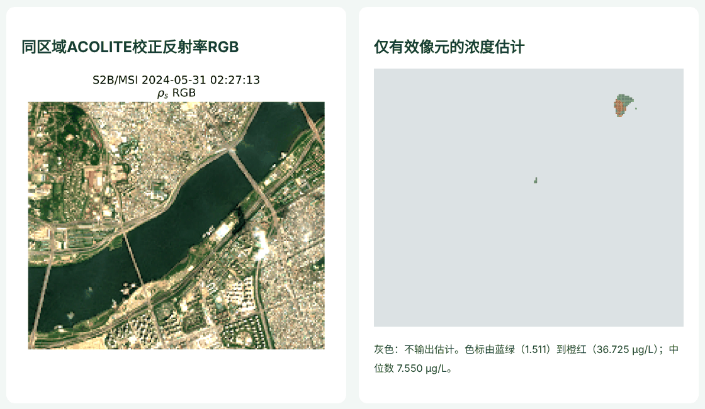

## 👋 关于我

我把模糊的需求做成**可验证的 AI 产品原型**：先定义用户问题和约束，再决定哪些交给模型、哪些必须由规则兜底，最后用评测数据说话。

- 🧭 **产品**：写 PRD、拆需求、设计评测指标，用 bad case 驱动迭代
- 🤖 **AI**：RAG、检索与排序、结构化输出校验，把概率性生成和确定性规则分层处理
- 🌊 **数据与科研**：海洋水色遥感、叶绿素 a 浓度反演、地形 Rossby 波研究

> **先想清楚，再量化；人始终在回路里。**

## 🚀 精选项目

### 🧳 [AI Trip Planner](https://github.com/wanghaorui413-stack/ai-trip-planner) · RAG 旅行规划 MVP

- **问题**：通用大模型生成的行程常常预算失控、节奏过载、输出无法自动评测。
- **做法**：RAG 只负责补充推荐理由；预算估算、候选生成、排序和校验交给确定性模块，输出结构化方案。从 [PRD](https://github.com/wanghaorui413-stack/ai-trip-planner/blob/main/docs/PRD.md)、指标定义到[离线评测脚本](https://github.com/wanghaorui413-stack/ai-trip-planner/blob/main/docs/EVALUATION.md)完整闭环。
- **结果**：24 个合成场景离线评测，**20 个通过，平均分 0.943**。4 个未通过的用例都是"体验优先"方案超预算不到 5%，已列为下一轮迭代点。

`Python` `FastAPI` `Streamlit` `FAISS` `LangChain` `Docker`

当前为 mock 数据阶段，评测结果不代表真实用户表现。

### 🌊 [Chlorophyll Lab](projects/chlorophyll-lab) · 叶绿素 a 浓度研究工程

- **问题**：从光谱估算水体叶绿素浓度，而且结论要经得起复现和审查。
- **做法**：GLORIA 实测光谱（质控后 3,385 条）→ 来源与水体分组隔离 → MLP / 1D CNN 对比选模 → 冻结评估。另一条管线把 Sentinel-2 L1C 经 ACOLITE 大气校正，输出带质量掩膜和溯源信息的 20 m 浓度 GeoTIFF。
- **结果**：保留集 log10 RMSE **0.2387**；**32 项本地测试通过**；卫星样例严格质检后保留 **124 / 35,055 像元（0.35%）**。

`Python` `PyTorch` `scikit-learn` `Rasterio` `Sentinel-2` `ACOLITE`

log10 RMSE 为历史开发评估，不是外部盲测；卫星浓度精度仍待独立实测匹配验证。

### 🖐️ [手势驱动的 3D 记忆相册](https://github.com/wanghaorui413-stack/gesture-memory-gallery) · Gesture Memory Gallery

- **问题**：一份生日礼物，想做得有仪式感、能放自己的照片、不用鼠标也能玩。
- **做法**：Three.js 粒子场景统一管理蛋糕、星光和照片；MediaPipe 在浏览器端识别手势：张开手散开照片、握拳回到蛋糕、捏合放大、挥手旋转。阈值按掌宽归一化，并用多帧确认过滤抖动。
- **结果**：照片只存在本地，可打包成一个 HTML 文件直接发送；没有摄像头时，按钮和触屏拖动也能完成全部操作。

`Three.js` `MediaPipe` `Vite` `JavaScript` `Canvas`

### 🧩 其他小工具

- [**IELTS Writing Coach**](https://github.com/wanghaorui413-stack/IELTS-Writing)：雅思写作工作台，集成题目筛选、限时写作、结构引导和实时规则反馈
- [**Daily Balance Planner**](https://github.com/wanghaorui413-stack/self-work-station)：按权重分配备考和科研时间，用近 7 天记录找出长期失衡的模块

## 🧭 我怎么做产品

1. **从用户问题出发**，先写清楚约束
2. **把概率性的 AI 行为和确定性的业务规则分开**
3. **让输出可检查**：校验、警告、评测用例缺一不可
4. **如实记录取舍**，让原型有机会长成真正的产品

## 🧰 工具箱

  
  
  
  
  
  
  
  
  
  

**产品能力**：PRD 撰写 · 需求拆解 · 指标与评测设计 · 原型验证 · 数据分析

## 🐍 贡献轨迹

<picture>
  <source media="(prefers-color-scheme: dark)" srcset="https://raw.githubusercontent.com/wanghaorui413-stack/wanghaorui413-stack/gh-pages/github-contribution-grid-snake-dark.svg" />
  
</picture>

## 📫 联系我

欢迎聊 AI 产品、数据驱动工具和跨学科问题：**[13701813467@163.com](mailto:13701813467@163.com)**

